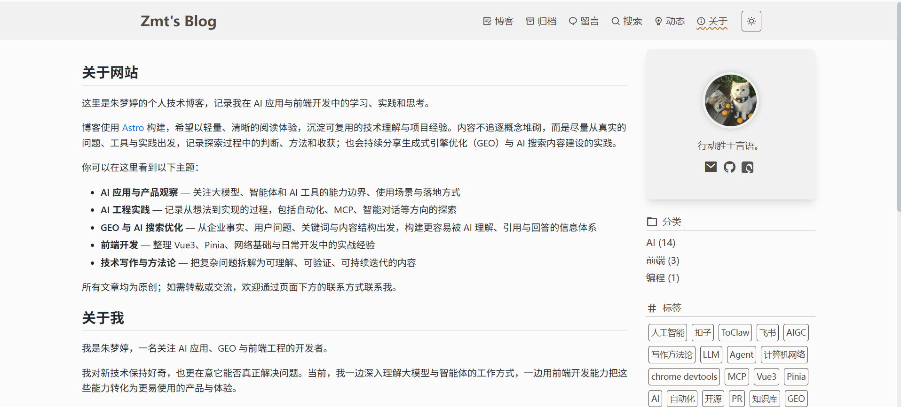

# Zmt's Blog

一个基于 [Astro](https://astro.build/) 构建的个人技术博客，记录 AI 应用、GEO、前端开发与持续学习中的实践和思考。

项目以内容优先，提供轻量、清晰的中文阅读体验；文章内容涵盖大模型与智能体、AI 搜索内容建设、GEO 方法论，以及前端开发实践。



## 功能特性

- Markdown 驱动的博客、动态与 GEO 系列内容
- 响应式布局，适配桌面与移动端
- 深色 / 浅色主题切换
- 标签、分类、按年份与月份归档，以及分页浏览
- 全文搜索
- RSS 与站点地图
- 图片懒加载、预览与本地头像资源
- 文章目录高亮、阅读页装饰与代码高亮、折叠、行号
- MathJax 数学公式支持
- 留言板与可选评论、访问统计配置
- 定制站点图标与品牌视觉资源

## 技术栈

- [Astro 5](https://astro.build/)
- TypeScript
- Tailwind CSS
- Markdown / MDX
- Fuse.js

## 本地运行

建议使用 Node.js 20 或更高版本，以及 pnpm 8 或更高版本。

```bash
git clone https://github.com/zhumengting01/BLOG.git
cd BLOG
pnpm install
pnpm dev
```

启动后访问终端显示的本地地址（通常为 `http://localhost:4321`）。

## 常用命令

```bash
pnpm dev       # 启动本地开发服务器
pnpm build     # 构建生产版本，输出至 dist/
pnpm preview   # 预览生产构建
```

## 写作与配置

| 目标 | 位置 |
| --- | --- |
| 发布博客文章 | `src/content/blog/` |
| 发布动态 | `src/content/feed/` |
| 修改站点名称、作者与导航 | `src/consts.ts` |
| 修改关于页 | `src/pages/about/about.md` |
| 修改头像与站点图片 | `public/`、`public/images/` |

文章采用 Markdown 格式。新增文章后执行 `pnpm dev` 即可在本地预览。

## 部署

项目已包含 Vercel 配置，可连接 GitHub 仓库后在 Vercel 中导入并自动部署。构建命令使用 `pnpm build`，产物目录为 `dist`。

若部署到 GitHub Pages，请先在 `src/consts.ts` 中设置：

```ts
export const site = {
  // ...
  url: 'https://用户名.github.io',
  baseUrl: '/仓库名',
}
```

若站点部署在自定义域名或仓库根路径，`baseUrl` 保持为空字符串即可。

## 致谢

本博客基于 [Astro Theme Yi](https://github.com/cirry/astro-yi) 二次定制。

## 许可证

本项目采用 [MIT License](./LICENSE)。
